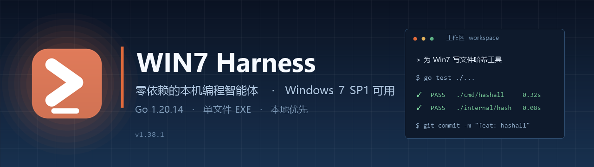
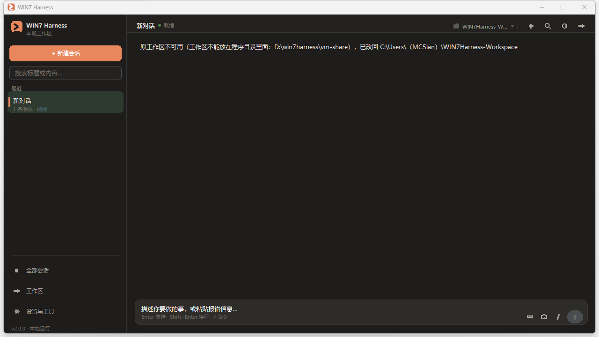
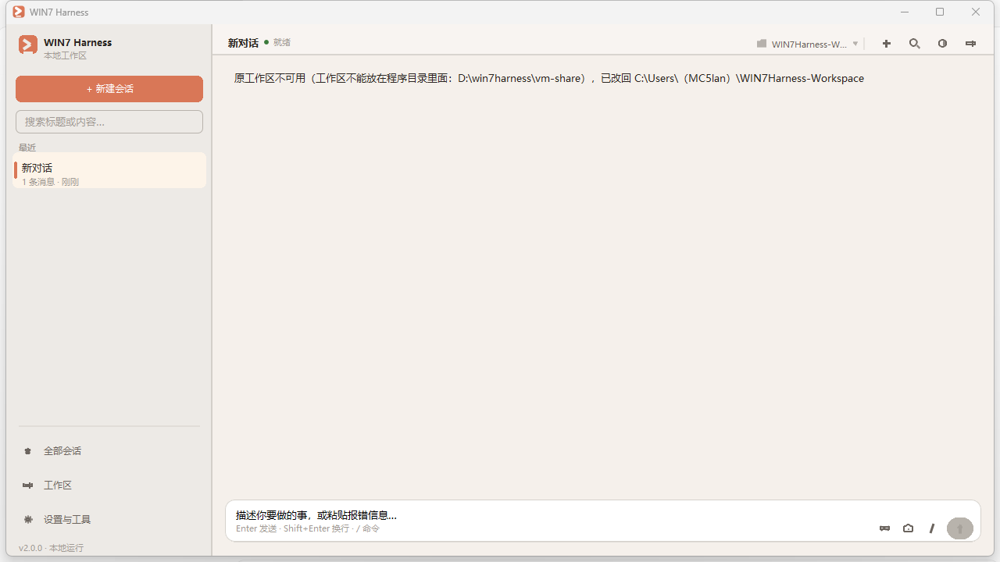
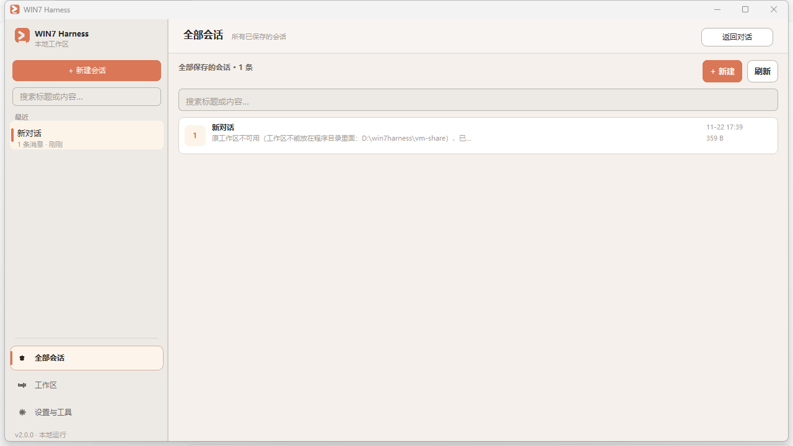
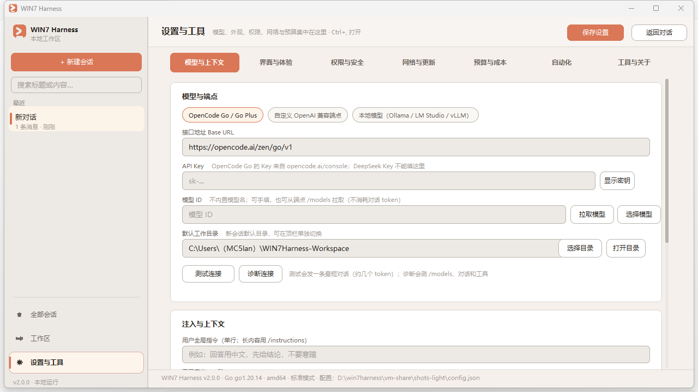
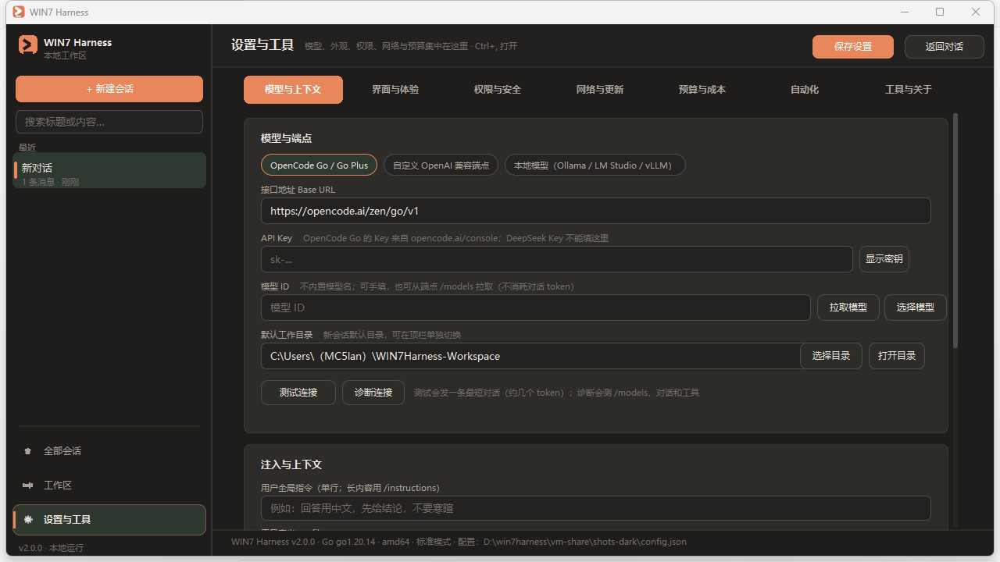
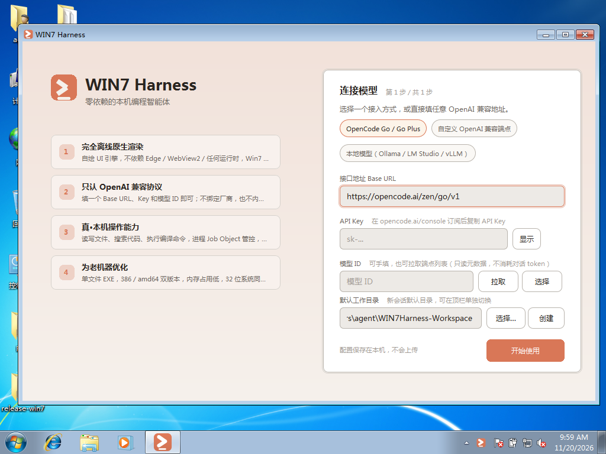

# WIN7 Harness

[中文文档（主语言）](README.md)

<p align="center">
  
</p>

<p align="center">
  
  
  
  
  
</p>

**A local AI coding agent that runs on Windows 7 SP1.** Pure Go, single EXE, no runtime dependencies. The UI is drawn with Win32 GDI / Canvas — no WebView2, .NET, Electron, or browser runtime.

> This repository is the **v2.0.0** snapshot. Chinese (`README.md`) is the primary documentation language; this English file is a convenience translation. Licensed under [Apache 2.0](LICENSE).

## Screenshots

<p align="center">
  
  
</p>

<p align="center">
  
  
  
</p>

<p align="center">
  
</p>

## Why Windows 7

Windows 7 is still the only option on many old, air-gapped, or offline machines, while modern AI coding tools require Win10+, WebView2, or Electron. WIN7 Harness targets:

- **Win7 SP1 baseline** — built with Go 1.20.14, amd64 and 386 binaries.
- **Single EXE** — no installers required for portable use.
- **Local-first** — config, sessions, and snapshots stay on your machine; network access is limited to the endpoints you configure.
- **Diagnosable** — built-in self-test, endpoint doctor, crash/stall dumps, and support bundles.

## Highlights

| Area | What you get |
| :--- | :--- |
| Model access | Any OpenAI Chat Completions compatible endpoint, or local models (Ollama / LM Studio / vLLM). |
| Coding agent | File read/write/edit, code search, command execution, tests, Git, MCP, sub-agents, skills. |
| Native UI | Single sidebar with new session / recent sessions / workspaces / settings; 7 categorized settings tabs; high-DPI, themes, command palette. |
| Auto-update | GitHub Releases + `SHA256SUMS.txt` verification by default; Ed25519 signed manifest optionally. Downloaded packages are staged, never auto-replace the running EXE. |
| Tray | Persistent system-tray icon with notifications and balloon messages. |
| Stress-tested | Win7 VM stress runs on both amd64 and 386 (240 sessions, 600 files, 5 window sizes, force-kill/restart): zero crashes, zero stalls, zero session loss. |

## Install

Download `WIN7Harness-v*-win7.zip` from [Releases](https://github.com/MC5lan/WIN7Harness/releases/latest). It contains the installer, both EXEs, documentation, and license files. Portable mode is supported.

## Build from source

```bash
# Go 1.20.14 required; Win7 compatibility depends on this version
CGO_ENABLED=0 GOOS=windows GOARCH=amd64 go build -o WIN7Harness-amd64.exe ./cmd/win7harness
CGO_ENABLED=0 GOOS=windows GOARCH=386   go build -o WIN7Harness-386.exe   ./cmd/win7harness
```

## Documentation

- [CHANGELOG.md](CHANGELOG.md) — release history
- [docs/](docs/) — design notes, Win32 API notes, stress-test methodology and results
- [COMMERCIAL.md](COMMERCIAL.md) — commercial support

Chinese remains the primary language of this project; translated docs may lag behind.
