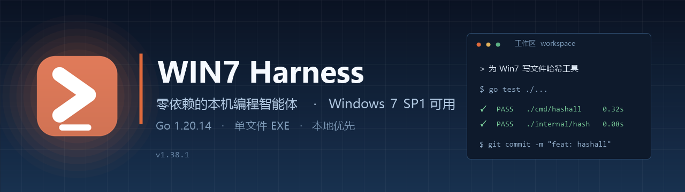
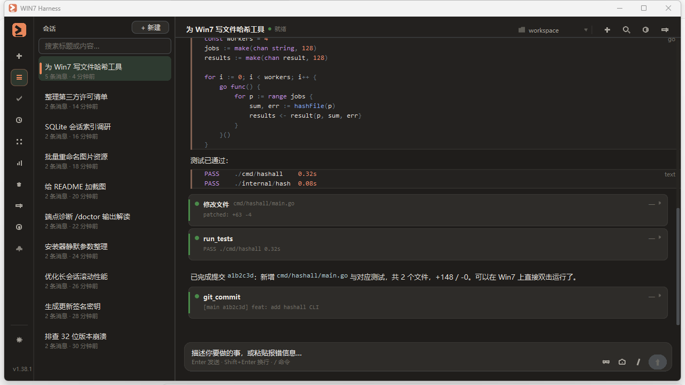
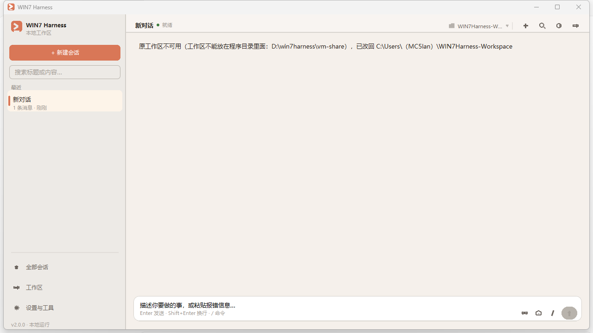
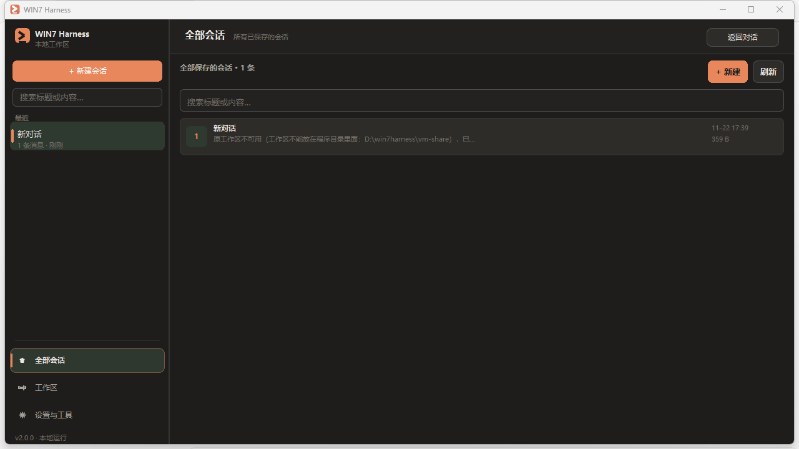
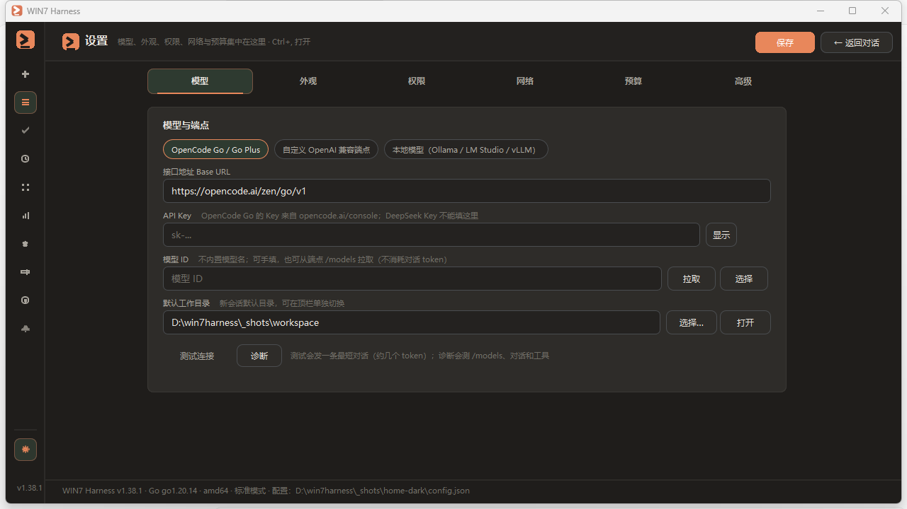
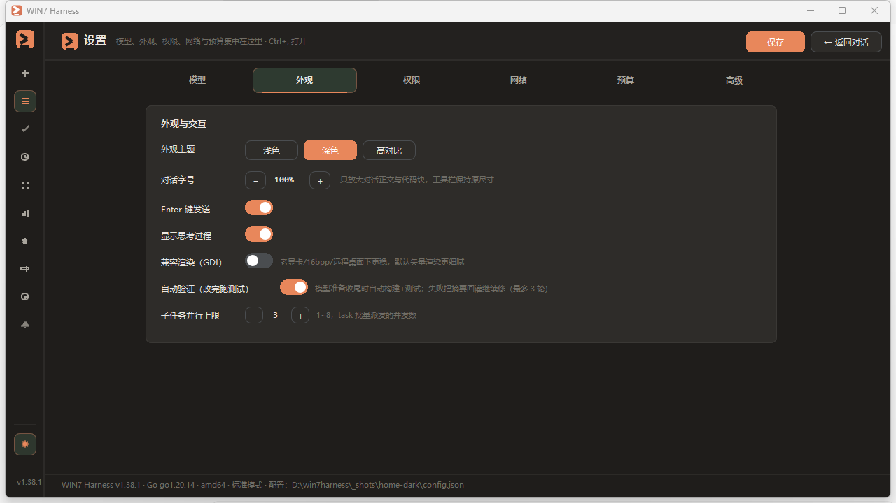
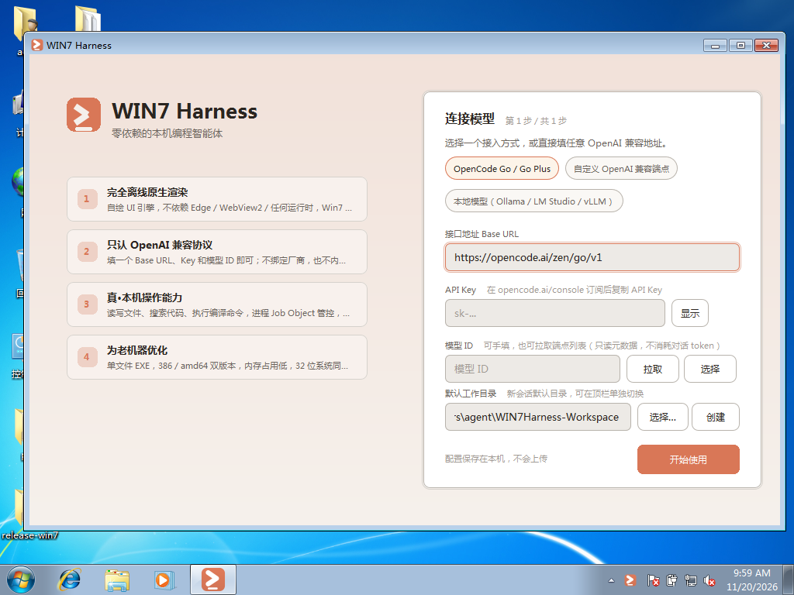
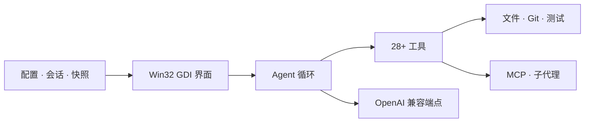

<p align="center">
  
</p>

<p align="center">
  
  
  
  
  
  
  
</p>

<p align="center">
  <b>在 Windows 7 SP1 上运行的本地 AI 编程智能体。</b><br>
  纯 Go、单文件、零运行时依赖；界面用 Win32 GDI / Canvas 自绘，不依赖 WebView2、.NET、Electron 或任何浏览器运行时。
</p>

> [!NOTE]
> **本项目使用 [Apache License 2.0](LICENSE)。** 允许个人与商业使用、修改、分发和私有部署，
> 无需单独授权；保留 `LICENSE` / `NOTICE` 与版权声明即可。商业支持见 [COMMERCIAL.md](COMMERCIAL.md)。
>
> **关于本仓库**：本仓库是 v1.39.1 的快照发布，早期迭代历史未提交到 git；
> 各版本变更见 [CHANGELOG.md](CHANGELOG.md) 与 `docs/`。

> 上文的“零运行时依赖”指静态链接的单文件 exe。构建期依赖 Go 1.20.14 工具链与
> `go.mod` 中列出的模块，详见 [THIRD_PARTY_NOTICES.md](THIRD_PARTY_NOTICES.md)。

---

## 界面预览

<p align="center">
  
  
</p>
<p align="center"><sub>对话界面：代码高亮、工具调用卡片、深色 / 浅色双主题</sub></p>

<p align="center">
  
  
  
</p>
<p align="center"><sub>会话中心 · 模型配置 · 外观设置</sub></p>

<p align="center">
  
</p>
<p align="center"><sub>真实的 Windows 7 SP1 桌面环境</sub></p>

---

## 为什么是 Windows 7

Windows 7 仍是很多老机器、内网机器和离线环境的唯一选择，但现代 AI 编程工具几乎都要求 Win10+、WebView2 或 Electron。WIN7 Harness 的目标是：

<table>
  <tr>
    <td align="center" width="25%">🪟<br><b>Win7 SP1 是底线</b></td>
    <td align="center" width="25%">📦<br><b>单 exe 即可运行</b></td>
    <td align="center" width="25%">🔒<br><b>本地优先</b></td>
    <td align="center" width="25%">🩺<br><b>可诊断</b></td>
  </tr>
  <tr>
    <td align="center" valign="top">Go 1.20.14 构建，32 / 64 位双产物，不依赖新系统 API。</td>
    <td align="center" valign="top">不安装运行库，不写注册表也能绿色运行。</td>
    <td align="center" valign="top">配置、会话、快照都在本机；只在你配置的模型端点联网。</td>
    <td align="center" valign="top">内置 77 项自检、端点诊断、崩溃 / 卡顿转储、支持包导出。</td>
  </tr>
</table>

## 核心能力

| 类别 | 能力 |
| :--- | :--- |
| 🤖 **模型接入** | OpenAI Chat Completions 兼容端点：OpenCode Go / Go Plus、DeepSeek、Moonshot、GLM、通义、SiliconFlow、Ollama、LM Studio、vLLM、llama.cpp server 等。 |
| 🛠️ **编程智能体** | 读 / 写 / 改文件、代码搜索、符号索引、命令执行、测试、Git 提交 / 回滚、补丁逐段审阅、项目长期记忆、内置技能包（9 个随 exe 分发）、MCP、子代理、并发任务。 |
| 🎨 **原生界面** | Win32 GDI / Canvas 自绘、聊天虚拟化、会话懒加载、高 DPI、主题、命令面板、快捷键、IME 输入。 |
| 💾 **安装方式** | 标准安装（当前用户 / 所有用户）或便携安装（U 盘 / 移动硬盘）。 |
| 🔑 **U 盘模式** | 配置、会话跟着 U 盘走；API Key 用 U 盘密码加密，换电脑输入密码即可。 |
| 🩺 **端点诊断 `/doctor`** | 分别探测 `/models`、最短对话、工具调用，直接显示上游错误。 |
| ⬆️ **自更新** | Ed25519 签名清单 + SHA256 校验；清单由 Release 提供，仅在发布 `latest.json` 后可用。所有用户安装会提示用安装包升级。 |
| 📴 **可离线** | 本地模型（Ollama / LM Studio / vLLM）不需要任何云端 Key。 |

## 架构一览



---

## 安装

### 方式一：安装包（推荐）

在 [Releases](https://github.com/MC5lan/WIN7Harness/releases/latest) 页面下载 `WIN7Harness-v*-win7.zip`（内含安装包、双架构 exe、使用说明、LICENSE 与 NOTICE）：

<p align="center">
  <a href="https://github.com/MC5lan/WIN7Harness/releases/latest"></a>
  <a href="https://github.com/MC5lan/WIN7Harness/releases/latest"></a>
  <a href="https://github.com/MC5lan/WIN7Harness/releases"></a>
</p>

- 最新版本：<https://github.com/MC5lan/WIN7Harness/releases/latest>
- 源码：在 Releases 页面的 “Source code” 区域下载，或直接 `git clone`
- [`release/`](release/) 目录不再提交构建产物

解压后双击 `WIN7Harness-v1.39.1-Setup.exe`：

1. 选择安装范围：仅当前用户（免管理员）或所有用户（Program Files + UAC）
2. 选择安装方式：标准安装 / 便携安装（U 盘）
3. 选择位置，安装，启动

标准安装的路径：

- 程序：`%LOCALAPPDATA%\Programs\Win7Harness` 或 `C:\Program Files\Win7Harness`
- 配置：`%APPDATA%\Win7Harness`
- 会话 / 日志 / 缓存：`%LOCALAPPDATA%\Win7Harness`

便携安装：

- 程序和数据：`X:\Win7Harness`（`data` 子目录）
- 不写注册表、不建快捷方式，换电脑直接双击 U 盘里的 exe

### 方式二：源码构建

要求：

- **Go 1.20.14**（Win7 能启动的最后一版；更高版本产物无法在 Win7 运行）
- `rsrc.exe`（把图标嵌进 PE）
- **Inno Setup 6.7.x**（只在 Windows 上编译安装包；7.x 不要用于 Win7 发布包）
- Python 3（仅 Linux 侧 `build.sh` 打包旧 ZIP 时需要）

Windows 一键构建：

```powershell
powershell -ExecutionPolicy Bypass -File build\build-release.ps1 -Test
```

Linux 交叉编译 exe：

```bash
./build.sh
```

## 系统要求

| 项目 | 要求 |
| :--- | :--- |
| 操作系统 | Windows 7 SP1 或更高（Win10 / 11 共用同一套二进制） |
| 建议补丁 | KB2533623、KB4474419、KB4490628、KB3140245（TLS / 根证书 / 更新相关） |
| 内存 | 2 GB 起；32 位进程有额外地址空间限制 |
| 磁盘 | 程序约 30 MB；会话、附件、快照会随使用增长 |
| 网络 | 只在你配置模型端点、检查更新或使用远程 MCP 时联网 |

## 快速开始

1. 启动后按引导选择接入方式：
   - **OpenCode Go / Go Plus**：Key 来自 <https://opencode.ai/console>
   - **自定义 OpenAI 兼容端点**：如 DeepSeek，Base URL `https://api.deepseek.com/v1`，模型 `deepseek-flash`
   - **本地模型**：Ollama / LM Studio / vLLM，通常不需要 Key
2. 填 Base URL、API Key、模型 ID（可点“拉取”从 `/models` 获取）。
3. 选工作目录。**不要把程序目录、`data` 目录选成工作区**，程序会拒绝。
4. 点“测试连接”或输入 `/doctor`。测试会发一条极短对话，验证 Key、模型和工具调用。
5. 在输入框描述任务，例如：`看一下 D:\proj 里有哪些 Go 文件，帮我加个 Makefile。`

常用命令：`/help`、`/doctor`、`/status`、`/context`、`/compact`、`/model`、`/dir`、`/update`、`/selftest`、`/crash`、`/export`。

内置技能随 exe 分发，不联网也能用：`repo-onboarding`（陌生仓库上手）、`go-fix-loop`（Go 修复闭环）、`bug-repro`（先复现再修）、`safe-refactor`（安全重构）、`review-diff`（代码评审）、`win7-compat`（Win7 兼容性）、`release-check`（发布检查）、`incident-triage`（崩溃/卡死排查）、`context-recovery`（长任务恢复）。在“扩展 → 技能”里可预览、复制到项目或禁用；项目/全局同名技能优先于内置。

## U 盘模式与密码

便携安装会把程序和数据放在 `X:\Win7Harness`：

```text
X:\Win7Harness\
  Win7Harness.exe
  portable.flag
  data\
    config.json
    sessions\
    ...
```

- 第一次在便携模式保存 API Key 时，程序会要求设置 **U 盘密码**。
- 密码只用于加密 API Key，不保存在 U 盘上；每次启动输入一次。
- 点“稍后”可以浏览会话，但调用模型前要解锁。
- 忘记密码：在解锁框点“忘记密码”，清空密文后重新填 Key。
- 密码只保护 Key，不保护会话 / 代码；U 盘防丢建议 BitLocker To Go 或 VeraCrypt。

## 构建与测试

```powershell
# 全量单元测试
go test ./...

# 安装器回归：标准安装 / 卸载 / 便携 / 覆盖升级 / 自检
powershell -ExecutionPolicy Bypass -File scripts\installer_regression.ps1

# 程序自检（不需要模型 Key）
.\dist\WIN7Harness-amd64.exe -selftest --offline
```

构建产物：

```text
dist/
  WIN7Harness-amd64.exe
  WIN7Harness-386.exe
  Win7Harness-v1.39.1-Setup.exe
  README.txt
  version.txt
  ...
```

## 目录结构

```text
assets/               README 用图标、横幅与实际界面截图
cmd/win7harness/      程序入口、CLI、自检 / 评测命令
internal/app/         界面、会话、设置、安装模式、U 盘密码 UI
internal/agent/       对话 - 工具循环、子代理、验证、成本
internal/llm/         OpenAI 兼容客户端、TLS / 代理、端点诊断
internal/tools/       28+ 工具：文件、命令、Git、测试、MCP、索引
internal/ui/          Win32 GDI / Canvas 自绘 UI、字体、主题
internal/core/        配置、策略、快照、会话索引、更新签名
build/                图标、安装器脚本、语言文件
docs/                 使用说明、设计 / 审计 / 兼容性文档
scripts/              安装器回归、UI 回归、生命周期检查
```

## 文档

| 文档 | 说明 |
| :--- | :--- |
| [使用说明（完整功能手册）](docs/使用说明.txt) | 全部功能、命令与配置说明 |
| [安装器、便携模式与 U 盘密码](docs/installer-v1.37.md) | 安装流程与便携模式细节 |
| [更新清单签名](docs/update-signing-v1.36.md) | Ed25519 签名与校验流程 |
| [Win7 兼容性路线图](docs/win7-cross-version-roadmap-v1.36.md) | 跨版本兼容策略 |
| [企业网络 / PAC / WPAD / CA](docs/win7-enterprise-network-v1.36.md) | 企业内网与证书配置 |
| [Canvas 渲染与故障排查](docs/canvas-render.md) | 自绘渲染与常见问题 |
| [Win32 API 注意事项](docs/win32-api-notes.md) | Win7 上的 API 使用边界 |
| [更新日志](CHANGELOG.md) | v1.7.0 → v1.39.1 的版本演进 |
| [贡献指南](CONTRIBUTING.md) | 红线、构建、验证与 PR 规范 |
| [依赖审计](docs/deps-audit.md) | 直接/间接依赖、许可证与裁剪结论 |
| [发布流程](docs/release-process.md) | 改版本、打 tag、签名与验证 `/update` |
| [安全策略](SECURITY.md) | 漏洞报告渠道与数据处理说明 |

## 安全与隐私

- API Key 标准模式用 Windows DPAPI，便携模式用 U 盘密码 + AES-256-GCM 加密。
- 支持包 `config.redacted.json` 会清空 Key / 密文；分享前仍建议自己检查。
- 更新清单支持 Ed25519 签名，下载文件校验 SHA256。
- 程序不内置遥测；只有你配置的模型端点、更新检查和远程 MCP 会联网。
- 发现安全问题请通过 [GitHub Security Advisories](https://github.com/MC5lan/WIN7Harness/security/advisories/new) 私下报告，不要公开贴 Key 或会话内容。

## 授权

本项目使用 **Apache License 2.0**（OSI 认可的开源许可证）：

| ✅ 允许 | ⚠️ 需要遵守 |
| :--- | :--- |
| 个人与商业使用、内部工具、SaaS、外包交付 | 保留 [LICENSE](LICENSE)、[NOTICE](NOTICE) 与版权声明 |
| 修改源码、私有部署、二次分发 | 修改过的文件需附显著变更说明 |
| 专利授权（贡献者专利许可） | 不得使用项目名称 / 图标暗示官方背书（§6） |
| 收费支持、咨询、定制开发 | 软件按 “AS IS” 提供，不附带担保（§7、§8） |

商业使用**无需**单独授权；可选的商业支持见 [COMMERCIAL.md](COMMERCIAL.md)。

第三方组件和构建工具的许可见 [THIRD_PARTY_NOTICES.md](THIRD_PARTY_NOTICES.md)。

## 免责声明

本软件按“现状”提供，不附带任何明示或暗示担保。模型输出、工具执行和命令运行可能出错；请在重要项目上使用版本控制并自行审查改动。API 调用产生的费用由你的服务商账户承担。

---

<p align="center">
  <sub>Built with Go 1.20.14 · Win32 GDI / Canvas · 无 WebView2 / .NET / Electron</sub>
</p>
